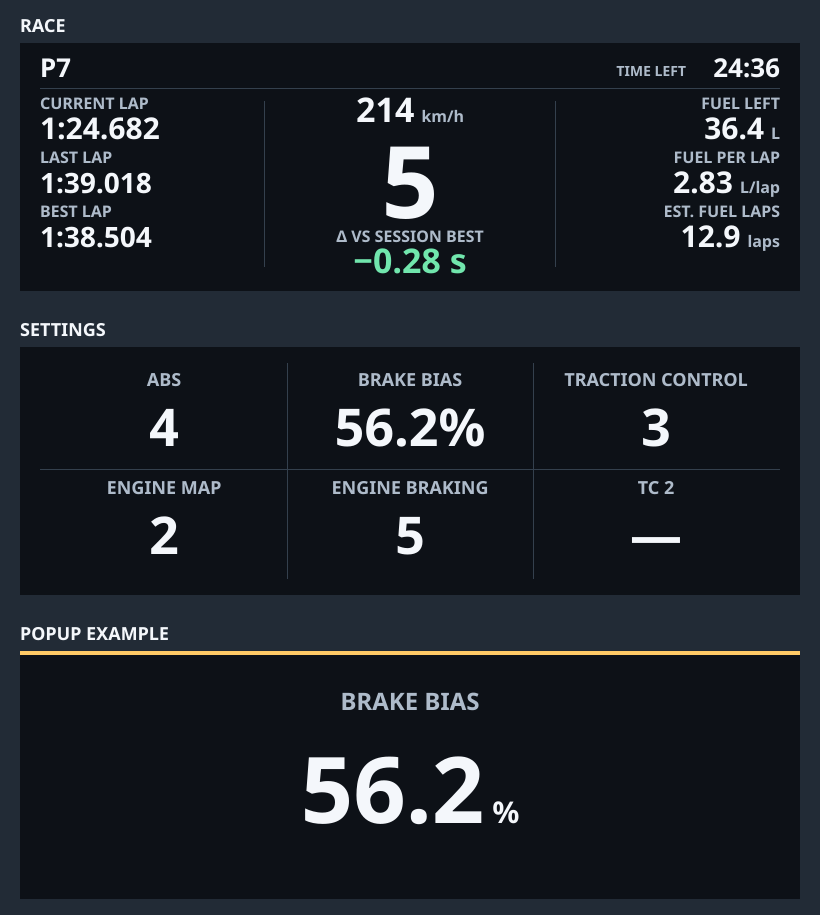

# MOZA dashboard design plan

Design draft for review. The prototype targets iRacing through SimHub and AZOM, with ATSR-Hub EVO handling the wheel lighting profile. The CS Pro and KS Pro are the target wheels. The supplied CS/KS Pro reference layout declares a **780 × 248 px** canvas. Use that for the mockups and confirm the dimensions, usable edges, and font in Dashboard Studio and on each wheel before export. [MOZA display overview](https://eu.mozaracing.com/es/blogs/news/moza-racing-ces-2026-porsche-mission-r-wheel) · [AZOM authoring and upload](https://giant.orth.cc/guides/wheel-files/)

## Visual rules

Use a flat charcoal background `#0D1117`, near-white values `#F4F7FB`, muted labels `#AEBBCA`, and subtle rules `#34404D`. Use a legible sans serif with tabular digits, bold numerals, and short uppercase labels. The preview uses Noto Sans. Match its numeral widths in Dashboard Studio with a font the wheel supports. Use a 20 px left and right inset and keep text away from the corners. Color supports signed values and named states. Avoid blinking, gradients, and decorative badges.

Sizes below are design targets in canvas pixels. Test the design at physical size from the normal driving position. For a roughly 3-inch diagonal, the complete 780 px canvas is about 72 mm wide. Use the physical wheel to decide whether any secondary information needs its own page.

## Main 1 · Race

The center carries the quickest glances. Timing stays on the left and fuel stays on the right. Coordinates are from the top-left of the canvas. Vertical positions for text in this plan are baselines.

| Area | Placement and size | Content |
| --- | --- | --- |
| Header | x 20 and x 760, y 34. Values 26 px | Overall position left, such as `P7`. Session time remaining right, such as `24:36`, with hours when needed. |
| Timing | x 20–239, labels at y 66, 120, 174. Values at y 96, 150, 204 | Current lap at 30 px, last and best at 28 px. Display `m:ss.sss`; allow multiple minute digits. |
| Driving | Center x 390, speed baseline y 79, gear y 175 | Speed at 34 px with `km/h` at 16 px. Gear at 100 px, including `N` and `R`. |
| Live delta | Center x 390, label y 199 and value y 230 | `Δ VS SESSION BEST` at 16 px and signed seconds at 34 px, e.g. `−0.28 s`. Mint `#71E6AD` for quicker, rose `#FF8994` for slower, white at zero. |
| Fuel | Right align at x 760, same three rows as timing | Fuel remaining `36.4 L`, consumption `2.83 L/lap`, and estimated laps on fuel `12.9 laps`. Labels at 16 px, numbers at 30 px, units at 16 px. |

Prefer the signed live delta because it answers whether the current lap is gaining or losing time at this point on track. Use a valid session-best reference and show a dash when the reference is unavailable. Keep the shift and flag LEDs on the ATSR-Hub EVO profile. Keep maps, pedal graphs, rival lists, and four-corner tyre data off this default page. Class position and laps to go are useful candidates for a later race strategy page. [iRacing timing, relative, and fuel displays](https://support.iracing.com/support/solutions/articles/31000167257-black-box-screen-information-and-controls) · [iRacing delta reference modes](https://support.iracing.com/support/solutions/articles/31000133605-clear-split-deltas-from-the-sim) · [AZOM and ATSR lighting](https://giant.orth.cc/guides/)

### Race bindings to verify

Shared paths below are relative to `DataCorePlugin.GameData.` unless written in full. Confirm the mapping and units in the installed versions before authoring the final wheel files. [Project SimHub property map](../telemetry/simhub.csv)

| Display | Preferred SimHub property | Presentation and checks |
| --- | --- | --- |
| Gear and speed | `Gear`, `SpeedKmh` | Integer gear with neutral and reverse labels, whole km/h independent of preferred local units. |
| Current, last, and best lap | `CurrentLapTime`, `LastLapTime`, `BestLapTime` | Convert to seconds if the wheel channel expects them. Blank last or best until a usable lap exists. |
| Position and session time | `Position`, `SessionTimeLeft` | Overall position. Show a dash if the session lacks a meaningful time limit. |
| Live lap delta | `DeltaToSessionBest` | Verify sign, scale, reference, and validity. iRacing fallback candidates are `LapDeltaToSessionBestLap` and its `_OK` flag. |
| Fuel remaining | `Fuel` | Verify litres with the installed SimHub configuration and actual AZOM channel. |
| Fuel per lap and estimated laps | `DataCorePlugin.Computed.Fuel_LitersPerLap`, `DataCorePlugin.Computed.Fuel_RemainingLaps` | Bind SimHub's estimates to suitable AZOM channels. Confirm scale and precision on the wheel. Show a dash while consumption history is insufficient. |

If the cockpit check fails, split Race into **Drive** and **Timing & Fuel**. Keep gear, speed, position, live delta, and estimated fuel laps on Drive. Put current, last, and best lap in a wide left column on Timing & Fuel, and fuel remaining, consumption per lap, and estimated laps in the right column. Keep session time in its header. Use the freed space to increase secondary values to 36 px or larger. Confirm a deliberate main-page switch and keep both pages eligible as popup return targets.

## Main 2 · Settings

Use a three-column, two-row grid. Column centers are x 144, 390, and 636. Row labels sit at y 39 and 147 in 18 px. Values sit at y 99 and 207 in 46–52 px. Place brake bias top center for the easiest glance. Use static colors and stable positions even when a car lacks one of the settings.

| Row | Left | Middle | Right |
| --- | --- | --- | --- |
| Top | ABS | Brake Bias | Traction Control |
| Bottom | Engine Map | Engine Braking | TC 2 |

Engine Braking and TC 2 are proposed for the two extra slots. Keep front/rear anti-roll bar and fuel mixture as candidates for a later settings page or a car-specific binding once their meaning is confirmed. Show `—` for unavailable values and `OFF` only when the car confirms an off state. iRacing can expose different in-car adjustments by car. [iRacing in-car adjustments](https://support.iracing.com/support/solutions/articles/31000167257-black-box-screen-information-and-controls) · [Project SDK catalog](../telemetry/iracing.csv)

## Settings popups

Each supported setting has its own uploaded dashboard slot, with a shared layout. Draw a 4 px amber rule `#FFCA66` at the top, a 24 px centered setting label at y 59, and a bold white value centered at x 390 with baseline y 172. Start at 92 px for values and reduce to 72 px for wider strings. Use a 30 px percent sign for bias and fit the longest expected state within the central 560 px. No countdown is shown. Settings and popup dashboards share the same formatter for each value.

| Popup | Trigger candidate in shared SimHub data | Display and iRacing fallback candidate |
| --- | --- | --- |
| Brake Bias | `BrakeBias` changes by one displayed step | Front bias percentage such as `56.2%` once validated. Compare `dcBrakeBias` against the cockpit. Some values may require a car-specific interpretation. |
| ABS | `ABSLevel` changes | Confirmed setting or `OFF`. Compare `dcABS` if needed. ABS engagement is a separate signal. |
| Traction Control | `TCLevel` changes | Confirmed setting or `OFF`. Compare `dcTractionControl` if needed. TC engagement is a separate signal. |
| Engine Map | `ECUMap` changes | Confirmed map number or short label. Check `dcEnginePower` only if it tracks the same cockpit control for the car. |
| Engine Braking | `EngineBrake` changes | Confirmed step or short label. Compare `dcEngineBraking` if needed. |
| TC 2 | `TC_B` changes | Confirmed second TC adjustment. Compare `dcTractionControl2` if needed. |

Read actual setting telemetry irrespective of whether the driver used a wheel control, keyboard, or an in-game menu. Keep one change detector per enabled setting. Seed from the first valid sample, normalize to the real setting step to ignore float noise, and suppress triggers while input is unavailable. Re-establish baselines on session, car, or source changes. Distinguish authoritative zero from unavailable data. When changes arrive in one sample, keep the newest change with a stable tie-break in the popup table order.

Use one editable duration setting in seconds for all popups, default **5.0 s**. Capture the current main slot once per popup sequence. Repeated adjustments update the live value and restart the deadline. A different setting selects its popup and restarts the same deadline. At expiry, return to the exact saved main page. A deliberate manual main selection during a popup cancels the sequence and takes precedence. Reset the sequence on disconnection or session change and re-establish the active main page when the wheel is ready. Keep popup slots out of normal main-page navigation.

## Implementation order and evidence

1. **Confirm the transport.** On the installed SimHub and AZOM versions, identify the active main slot, test exact slot selection, and check wheel-side confirmation. Recent AZOM release notes list `AZOM.DashboardName`. Public actions list next and previous, so check whether there is a supported direct selection interface before choosing the controller integration. If an AZOM change is required, scope that change before adding more popup files. Confirm that two main slots plus six popup slots fit and that ATSR-Hub EVO remains active through page changes. [AZOM releases](https://github.com/giantorth/AZOM/releases) · [AZOM action reference](https://giant.orth.cc/guides/properties-and-actions/)
2. **Prove Race → Brake Bias → Race on hardware.** Use iRacing and a car with adjustable bias. Bind the live value, adjust up and down, then try two changes three seconds apart. With the default timeout, the main returns eight seconds after the first change. Verify with real telemetry plus replay if the relevant values survive recording.
3. **Build both main layouts and remaining popups.** Fill the Race and Settings bindings, keep formats consistent, and enable each popup only where its setting source is verified. Check neutral and reverse, long lap times, unavailable values, sign and units, 100% bias formatting, and longer setting labels. Compare fuel after enough laps for SimHub to estimate consumption.
4. **Review readability and switching.** Read the wheel at the normal driving distance in daylight and low light. Check that the gear and delta are legible at a glance and every requested field can be read without leaning in. Try mixed setting changes, manual page selection, session resets, and a second main page as the saved return target. Use the split layout if needed. Record car, wheel, firmware, plugin versions, and what was verified. Keep editable layouts, exports, bindings, and install instructions together.

For design review, the two decisions are whether the dense Race page reads comfortably at wheel size, and whether Engine Braking and TC 2 are the best two extra settings for the cars you drive.
